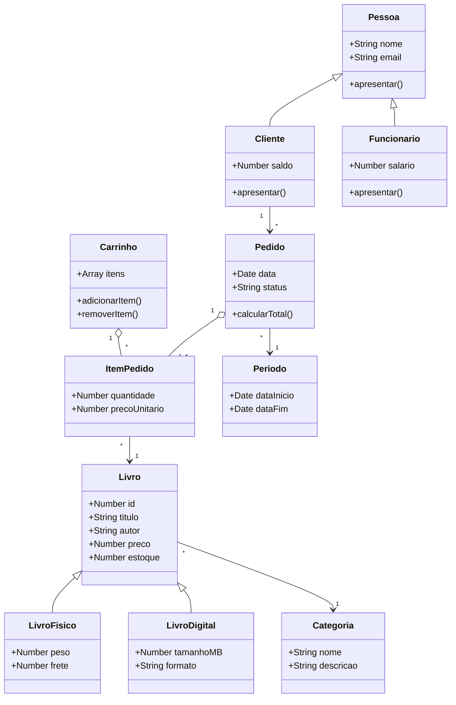
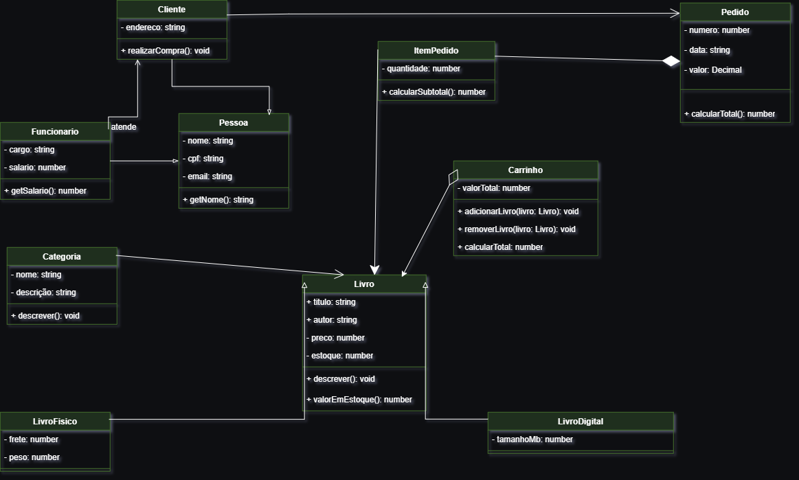

# API de Gestão da Livraria — Grupo 3

Projeto da UC de Programação Back-End — Curso Técnico em Desenvolvimento de Sistemas  
Escola SENAI "Santo Paschoal Crepaldi" — Turma 1-2026-SESI_DEV_OC_1

API REST para gerenciar o catálogo de uma livraria, feita com Node.js, Express e MySQL. Permite cadastrar, consultar, alterar e excluir **livros** e **categorias**.

## Sumário

- [Integrantes](#integrantes)
- [Tecnologias](#tecnologias)
- [Pré-requisitos](#pré-requisitos)
- [Como executar o projeto](#como-executar-o-projeto)
- [Variáveis de ambiente](#variáveis-de-ambiente)
- [Banco de dados](#banco-de-dados)
- [Estrutura do projeto](#estrutura-do-projeto)
- [Como a API funciona](#como-a-api-funciona)
- [Rotas da API](#rotas-da-api)
- [Validações e tratamento de erros](#validações-e-tratamento-de-erros)
- [IDs dos registros](#ids-dos-registros)
- [Testes](#testes)
- [Problemas comuns](#problemas-comuns)
- [Limitações conhecidas](#limitações-conhecidas)
- [Cronograma do projeto](#cronograma-do-projeto)
- [Diagramas de classes](#diagramas-de-classes)

## Integrantes

- Luis Miguel Pereira da Silva — @LuisSilva-del
- Ana Laura Aparecida Miranda Cardoso — @Ana
- Victor dos Santos Gonçalves da Silva — @Gonçalves918
- Maria Eduarda da Silva Mendes — @madumendes21

## Tecnologias

| Tecnologia | Uso | Versão no `package.json` |
| :--- | :--- | :--- |
| Node.js | Ambiente de execução | 18 ou superior (exigência do Express 5) |
| Express | Servidor e rotas | ^5.2.1 |
| mysql2 | Conexão com o MySQL (com Promises) | ^3.24.6 |
| dotenv | Leitura das variáveis do arquivo `.env` | ^18.0.9 |
| nodemon | Reinicia o servidor ao salvar arquivos (desenvolvimento) | ^3.1.14 |
| MySQL | Banco de dados dos livros | — |
| Postman | Testes das rotas | — |

## Pré-requisitos

- [Node.js](https://nodejs.org/) 18 ou superior (inclui o npm)
- [MySQL](https://dev.mysql.com/downloads/) instalado e em execução
- [Git](https://git-scm.com/)
- [Postman](https://www.postman.com/) ou Insomnia, para testar as rotas

## Como executar o projeto

**1. Clone o repositório e entre na pasta**

```bash
git clone https://github.com/LuisSilva-del/livraria-api-grupo3.git
cd livraria-api-grupo3
```

**2. Instale as dependências**

```bash
npm install
```

**3. Crie o arquivo `.env`**

No PowerShell:

```powershell
Copy-Item .env.example .env
```

Abra o `.env` e troque `sua_senha_aqui` pela senha do seu MySQL. Veja todas as variáveis em [Variáveis de ambiente](#variáveis-de-ambiente).

**4. Crie o banco de dados**

> **Atenção:** o arquivo `src/database/livraria.sql` começa com `DROP DATABASE IF EXISTS livraria;`. Ao executá-lo, o banco `livraria` é apagado e recriado, e todos os dados que estavam nele são perdidos.

Na raiz do projeto, abra o cliente do MySQL e execute o script:

```bash
mysql -u root -p
```

```sql
source src/database/livraria.sql
```

Outra opção é abrir o arquivo `src/database/livraria.sql` no MySQL Workbench e executá-lo por lá.

**5. Inicie a API**

```bash
npm run dev
```

**6. Confirme que está funcionando**

No terminal devem aparecer:

```text
Servidor rodando em http://localhost:3000
Conectado ao MySQL!
```

Se aparecer `ERRO ao conectar no MySQL`, veja [Problemas comuns](#problemas-comuns). Você também pode abrir `http://localhost:3000` no navegador: a resposta esperada é o texto `API da Livraria no ar!`.

O `package.json` tem dois scripts:

| Comando | O que faz |
| :--- | :--- |
| `npm run dev` | Inicia a API com o nodemon, que reinicia o servidor ao salvar um arquivo (use no desenvolvimento) |
| `npm start` | Inicia a API com o Node, sem reiniciar sozinha |

## Variáveis de ambiente

As variáveis ficam no arquivo `.env`, que **não** é enviado ao GitHub (está no `.gitignore`). O modelo está em `.env.example`.

| Variável | Descrição | Valor do exemplo |
| :--- | :--- | :--- |
| `DB_HOST` | Endereço do servidor MySQL | `localhost` |
| `DB_PORT` | Porta do MySQL | `3306` |
| `DB_USER` | Usuário do MySQL | `root` |
| `DB_PASSWORD` | Senha do MySQL | `sua_senha_aqui` |
| `DB_NAME` | Nome do banco | `livraria` |
| `PORT` | Porta da API (opcional; se não existir, usa `3000`) | — |

## Banco de dados

O script `src/database/livraria.sql` cria o banco `livraria` e a tabela `livros`.

| Coluna | Tipo | Regras |
| :--- | :--- | :--- |
| `id` | `INT` | Chave primária, `AUTO_INCREMENT` |
| `titulo` | `VARCHAR(150)` | `NOT NULL` |
| `autor` | `VARCHAR(100)` | `NOT NULL` |
| `preco` | `DECIMAL(10, 2)` | `NOT NULL` |
| `estoque` | `INT` | `NOT NULL` |

O script também insere três livros de exemplo:

| titulo | autor | preco | estoque |
| :--- | :--- | ---: | ---: |
| Clean Code | Robert C. Martin | 89.90 | 12 |
| Eloquent JavaScript | Marijn Haverbeke | 45.00 | 20 |
| O Hobbit | J.R.R. Tolkien | 39.90 | 8 |

As **categorias não ficam no MySQL**: são guardadas em memória (veja [Limitações conhecidas](#limitações-conhecidas)).

Para conferir os dados direto no banco:

```sql
USE livraria;
SELECT * FROM livros;
```

## Estrutura do projeto

```text
livraria-api-grupo3/
├── docs/
│   ├── cronograma.md
│   ├── livro.drawio.png
│   └── Livraria API - Entrega do Bloco 3.postman_collection.json
├── postman/
│   ├── collections/Livraria API - Entrega do Bloco 3/
│   ├── globals/workspace.globals.yaml
│   └── livraria.postman_collection.json
├── src/
│   ├── config/
│   │   └── db.js
│   ├── controllers/
│   │   ├── categoriaController.js
│   │   └── livroController.js
│   ├── database/
│   │   └── livraria.sql
│   ├── middlewares/
│   │   ├── logger.js
│   │   ├── rotaNaoEncontrada.js
│   │   ├── tratarErros.js
│   │   └── validarId.js
│   ├── models/
│   │   ├── Categoria.js
│   │   ├── Cliente.js
│   │   ├── Funcionario.js
│   │   ├── Livro.js
│   │   └── Pessoa.js
│   ├── routes/
│   │   ├── categoriaRoutes.js
│   │   ├── index.js
│   │   └── livroRoutes.js
│   ├── services/
│   │   ├── categoriaService.js
│   │   └── livroService.js
│   └── index.js
├── .env.example
├── .gitignore
├── package.json
├── testar.js
└── README.md
```

| Pasta ou arquivo | Função |
| :--- | :--- |
| `src/index.js` | Cria o servidor, registra os middlewares e as rotas e inicia a API |
| `src/config/db.js` | Cria a conexão (pool) com o MySQL e a função que testa a conexão |
| `src/routes/` | Liga cada URL e método HTTP a uma função do controller |
| `src/controllers/` | Recebe a requisição, chama o service e devolve a resposta com o status HTTP |
| `src/services/` | Contém as validações e o acesso aos dados |
| `src/models/` | Classes do domínio (`Pessoa`, `Cliente`, `Funcionario`, `Livro`, `Categoria`) |
| `src/middlewares/` | Funções que rodam entre a requisição e a resposta (log, validação de ID, erros) |
| `src/database/` | Script SQL que cria o banco |
| `postman/` e `docs/` | Coleção do Postman, diagrama e cronograma |
| `testar.js` | Teste simples das classes `Cliente`, `Funcionario` e `Livro`, sem banco: `node testar.js` |

## Como a API funciona

O caminho de uma requisição:

```text
Requisição → express.json → logger → routes → (validarId) → controller → service → resposta
```

- `express.json()` converte o corpo JSON da requisição em objeto (`req.body`).
- `logger` imprime no terminal a data, o método e a URL de cada requisição.
- `routes` escolhe o controller de acordo com a URL.
- `validarId` (nas rotas com `:id`, de livros e de categorias) recusa IDs que não sejam números inteiros.
- O `controller` valida os dados e escolhe o status HTTP; o `service` conversa com o MySQL (livros) ou com a lista em memória (categorias).
- Se nenhuma rota atender à URL, `rotaNaoEncontrada` responde 404. Erros inesperados passam por `tratarErros`.

Os **livros** usam consultas parametrizadas (`?`) no `mysql2`, o que evita SQL Injection.

## Rotas da API

As rotas seguem o padrão REST: os recursos têm nomes no plural e o método HTTP indica a operação. As rotas que trabalham com um registro específico usam o `id` dele.

**Rotas gerais**

| Método | Rota | Resposta |
| :--- | :--- | :--- |
| GET | `/` | Texto `API da Livraria no ar!` |
| GET | `/sobre` | Texto com a identificação do trabalho |

### Livros

| Método | Rota | Descrição | Status |
| :--- | :--- | :--- | :---: |
| GET | `/livros` | Lista os livros (aceita filtros) | 200 |
| GET | `/livros/:id` | Busca um livro pelo ID | 200, 400 ou 404 |
| POST | `/livros` | Cadastra um livro | 201 ou 400 |
| PUT | `/livros/:id` | Atualiza todos os dados do livro | 200, 400 ou 404 |
| PATCH | `/livros/:id` | Atualiza parte dos dados do livro | 200, 400 ou 404 |
| DELETE | `/livros/:id` | Exclui um livro | 204, 400 ou 404 |

**Filtros do `GET /livros`**

| Parâmetro | Como funciona | Exemplo |
| :--- | :--- | :--- |
| `titulo` | Livros cujo título contém o texto, sem diferenciar maiúsculas de minúsculas | `/livros?titulo=clean` |
| `autor` | Livros cujo autor contém o texto, sem diferenciar maiúsculas de minúsculas | `/livros?autor=martin` |
| `precoMax` | Livros com preço menor ou igual ao valor | `/livros?precoMax=50` |

Os filtros podem ser combinados: `/livros?autor=tolkien&precoMax=40`.

**Campos do livro**

| Campo | Tipo | Regra |
| :--- | :--- | :--- |
| `titulo` | texto | Obrigatório no POST e no PUT; não pode ser vazio (máximo de 150 caracteres) |
| `autor` | texto | Obrigatório no POST e no PUT; não pode ser vazio (máximo de 100 caracteres) |
| `preco` | número | Obrigatório no POST e no PUT; maior ou igual a 0 |
| `estoque` | número inteiro | Obrigatório no POST e no PUT; maior ou igual a 0 |

No PATCH todos os campos são opcionais, mas os que forem enviados seguem as mesmas regras.

O `id` é gerado pelo banco e não deve ser enviado.

**Exemplo: `POST /livros`**

Cabeçalho: `Content-Type: application/json`

```json
{
  "titulo": "Livro Teste Entrega",
  "autor": "Grupo",
  "preco": 10,
  "estoque": 1
}
```

Resposta (`201 Created`):

```json
{
  "id": 4,
  "titulo": "Livro Teste Entrega",
  "autor": "Grupo",
  "preco": 10,
  "estoque": 1
}
```

**Exemplo: `PATCH /livros/4`** (altera só o preço)

```json
{
  "preco": 15
}
```

**Exemplo: `DELETE /livros/4`** — resposta `204 No Content`, sem corpo.

### Categorias

| Método | Rota | Descrição | Status |
| :--- | :--- | :--- | :---: |
| GET | `/categorias` | Lista as categorias | 200 |
| GET | `/categorias/:id` | Busca uma categoria pelo ID | 200, 400 ou 404 |
| POST | `/categorias` | Cadastra uma categoria | 201 ou 400 |
| PUT | `/categorias/:id` | Atualiza todos os dados da categoria | 200, 400 ou 404 |
| PATCH | `/categorias/:id` | Atualiza parte dos dados da categoria | 200, 400 ou 404 |
| DELETE | `/categorias/:id` | Exclui uma categoria | 204, 400 ou 404 |

O PUT e o PATCH respondem com a categoria já atualizada.

**Campos da categoria**

| Campo | Tipo | Regra |
| :--- | :--- | :--- |
| `nome` | texto | Obrigatório no POST e no PUT; mínimo de 3 letras |
| `descricao` | texto | Opcional |

Ao iniciar a API já existe uma categoria de exemplo (`id` 1, nome `Infantil`).

**Exemplo: `POST /categorias`**

```json
{
  "nome": "Tecnologia",
  "descricao": "Livros de programacao"
}
```

Resposta (`201 Created`):

```json
{
  "id": 2,
  "nome": "Tecnologia",
  "descricao": "Livros de programacao"
}
```

## Validações e tratamento de erros

Todas as respostas de erro têm o mesmo formato:

```json
{
  "erro": "mensagem explicando o problema"
}
```

| Status | Quando acontece | Mensagem |
| :---: | :--- | :--- |
| 400 | Corpo ausente ou sem o cabeçalho `Content-Type: application/json` | `Envie os dados do livro em JSON` / `Envie os dados da categoria em JSON` |
| 400 | JSON com erro de escrita | `O JSON enviado esta mal escrito` |
| 400 | ID da URL não é um número inteiro positivo (livros e categorias) | `O id deve ser um numero inteiro` |
| 400 | Campo obrigatório do livro ausente | `O titulo e obrigatorio`, `O autor e obrigatorio`, `O preco e obrigatorio` ou `O estoque e obrigatorio` |
| 400 | Título ou autor que não é texto ou está vazio | `O titulo deve ser um texto nao vazio` / `O autor deve ser um texto nao vazio` |
| 400 | Preço negativo ou que não é número | `O preco deve ser um numero maior ou igual a zero` |
| 400 | Estoque negativo ou que não é número | `O estoque deve ser um numero maior ou igual a zero` |
| 400 | Estoque que não é inteiro (por exemplo, `1.5`) | `O estoque deve ser um numero inteiro` |
| 400 | Categoria sem nome | `O nome e obrigatorio` |
| 400 | Nome da categoria com menos de 3 letras | `O nome deve ter pelo menos 3 letras` |
| 400 | Texto ou número grande demais para a coluna do banco | `Algum valor e grande demais para o banco` |
| 404 | Livro ou categoria não existe | `Livro nao encontrado` / `Categoria nao encontrada` |
| 404 | Rota que não existe | `Rota nao encontrada` |
| 503 | MySQL fora do ar ou inacessível | `Banco de dados indisponivel` |
| 500 | Qualquer outro erro inesperado | `Erro interno no servidor` |

## IDs dos registros

Os livros e as categorias têm IDs sequenciais. As operações de busca, atualização e exclusão usam esses IDs.

O ID não representa a posição do registro na lista. Excluir um registro não altera os IDs dos outros, e um ID excluído não é reutilizado automaticamente. Nas categorias isso vale durante a execução do servidor (a contagem recomeça em 1 quando ele reinicia); nos livros, quem controla é o `AUTO_INCREMENT` do MySQL.

## Testes

### Postman

A coleção **Livraria API - Entrega do Bloco 3** está na pasta `postman/collections/` e também exportada em JSON em `docs/` e `postman/`. Ela usa a variável `baseUrl` (`http://localhost:3000`) e guarda automaticamente os IDs criados em `livroId` e `categoriaId`.

| Pasta | O que testa |
| :--- | :--- |
| 1 - Livros | CRUD completo: listar, cadastrar, buscar, filtrar, PATCH, PUT, estoque negativo, apagar e buscar o livro apagado |
| 2 - Categorias | CRUD completo de categorias |
| 3 - Erros | Livro sem título, preço negativo, preço em texto, sem `Content-Type`, categoria sem nome, nome curto e rota inexistente |
| Erros do Banco | Título e preço grandes demais para o banco |

Execute as requisições de cada pasta **na ordem numerada**: as últimas dependem do ID criado pela segunda.

Para testar manualmente uma rota no Postman:

1. Escolha o método e informe a URL, por exemplo `http://localhost:3000/livros`.
2. Em **Body**, marque **raw** e **JSON** (nos métodos POST, PUT e PATCH) e escreva o corpo.
3. Confira o status e o corpo da resposta. Para testar o erro 404, consulte um ID que não existe, como `/livros/9999`.

### PowerShell

```powershell
Invoke-RestMethod http://localhost:3000/livros
```

```powershell
Invoke-RestMethod -Method Post -Uri http://localhost:3000/livros -ContentType "application/json" -Body '{"titulo":"Livro Teste","autor":"Grupo","preco":10,"estoque":1}'
```

### Classes do domínio

O arquivo `testar.js` instancia `Cliente`, `Funcionario` e `Livro` e imprime o resultado no terminal. Não precisa de banco:

```bash
node testar.js
```

## Problemas comuns

| Problema | Causa provável | O que fazer |
| :--- | :--- | :--- |
| `ERRO ao conectar no MySQL` no terminal | MySQL desligado ou `.env` com dados errados | Inicie o MySQL e confira `DB_HOST`, `DB_PORT`, `DB_USER`, `DB_PASSWORD` e `DB_NAME` |
| Resposta 503 `Banco de dados indisponivel` | A API perdeu a conexão com o MySQL | Verifique se o MySQL está em execução |
| Erro de banco desconhecido ou tabela inexistente | O script SQL não foi executado | Execute o `src/database/livraria.sql` (passo 4) |
| `Cannot find module` | Dependências não instaladas | Rode `npm install` |
| Resposta 400 `Envie os dados do livro em JSON` | Faltou o cabeçalho `Content-Type: application/json` | Adicione o cabeçalho ou use **raw → JSON** no Postman |
| Resposta 400 `O JSON enviado esta mal escrito` | Vírgula, aspas ou chave errada no corpo | Corrija o JSON |
| `EADDRINUSE` ao iniciar | A porta 3000 já está em uso | Feche o outro programa ou defina outra `PORT` no `.env` |
| Categorias sumiram | A lista é em memória e foi perdida ao reiniciar | Comportamento esperado hoje; veja as limitações abaixo |

## Limitações conhecidas

- As **categorias** são guardadas em memória: os dados criados são perdidos quando o servidor reinicia. Apenas os livros usam o MySQL.
- Livros e categorias ainda não estão relacionados no banco, embora o diagrama de classes preveja essa ligação.
- Os filtros do `GET /livros` são aplicados no JavaScript depois de buscar todos os livros do banco. Com muitos registros, o ideal é filtrar direto no SQL com `WHERE` e `?`.

## Cronograma do projeto

O cronograma da atividade de PSOF está em [`docs/cronograma.md`](docs/cronograma.md).

## Diagramas de classes

O diagrama representa o domínio planejado. Nem todas as classes foram implementadas: hoje existem `Pessoa`, `Cliente`, `Funcionario`, `Livro` e `Categoria` em `src/models/`.

### Mermaid



### draw.io


