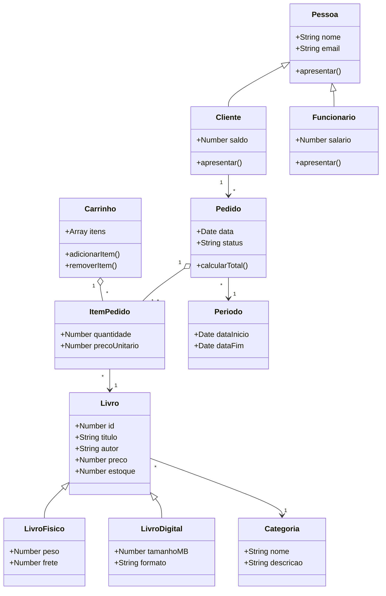

# API de Gestão da Livraria — Grupo 3

Projeto da UC de Programação Back-End — Curso Técnico em Desenvolvimento de Sistemas  
Escola SENAI "Santo Paschoal Crepaldi" — Turma 1-2026-SESI_DEV_OC_1

## Integrantes

- Luis Miguel Pereira da Silva — @LuisSilva-del
- Ana Laura Aparecida Miranda Cardoso — @Ana
- Victor dos Santos Gonçalves da Silva — @Gonçalves918
- Maria Eduarda da Silva Mendes — @madumendes21

## Tecnologias

- Node.js
- Express
- npm

## Como executar o projeto

1. Clone o repositório.
2. Abra a pasta do projeto no terminal.
3. Instale as dependências:

```bash
npm install
```

4. Inicie a API:

```bash
npm run dev
```

A API utiliza armazenamento em memória. Por isso, os registros criados durante a execução são perdidos quando o servidor é reiniciado.

## Rotas da API

As rotas seguem o padrão REST: os recursos são identificados por nomes no plural, e o método HTTP indica a operação. As rotas que trabalham com um registro específico utilizam seu `id`, e não a posição dele no array.

### Livros

| Método | Rota | Descrição | Status esperado |
| :--- | :--- | :--- | :---: |
| GET | `/livros` | Lista os livros | 200 |
| GET | `/livros/:id` | Busca um livro pelo ID | 200 ou 404 |
| POST | `/livros` | Cadastra um livro | 201 |
| PUT | `/livros/:id` | Atualiza todos os dados do livro | 200 ou 404 |
| PATCH | `/livros/:id` | Atualiza parte dos dados do livro | 200 ou 404 |
| DELETE | `/livros/:id` | Exclui um livro | 204 ou 404 |

### Categorias

| Método | Rota | Descrição | Status esperado |
| :--- | :--- | :--- | :---: |
| GET | `/categorias` | Lista as categorias | 200 |
| GET | `/categorias/:id` | Busca uma categoria pelo ID | 200 ou 404 |
| POST | `/categorias` | Cadastra uma categoria | 201 |
| PUT | `/categorias/:id` | Atualiza todos os dados da categoria | 200 ou 404 |
| PATCH | `/categorias/:id` | Atualiza parte dos dados da categoria | 200 ou 404 |
| DELETE | `/categorias/:id` | Exclui uma categoria | 204 ou 404 |

Os códigos de status indicam o resultado esperado de cada operação. O status efetivamente obtido deve ser confirmado durante os testes no Insomnia ou Postman.

## IDs dos registros

Os livros e as categorias recebem IDs sequenciais quando são criados. As operações de busca, atualização e exclusão utilizam esses IDs.

O ID não representa a posição do registro na lista. Por isso, excluir um registro não altera os IDs dos outros e o contador não reutiliza automaticamente um ID excluído durante a mesma execução do servidor.

## Testes

Os endpoints podem ser testados pelo Insomnia ou Postman. Para testar um recurso existente, use seu ID na URL. Para verificar o tratamento de erro, tente consultar um ID que não exista; a API deve retornar `404 Not Found`.

Ao enviar dados em requisições POST, PUT ou PATCH, utilize o corpo em JSON e o cabeçalho `Content-Type: application/json`.

## Cronograma do Projeto

O cronograma da atividade de PSOF está em [`docs/cronograma.md`](docs/cronograma.md).

## Diagrama de Classes (UML)


